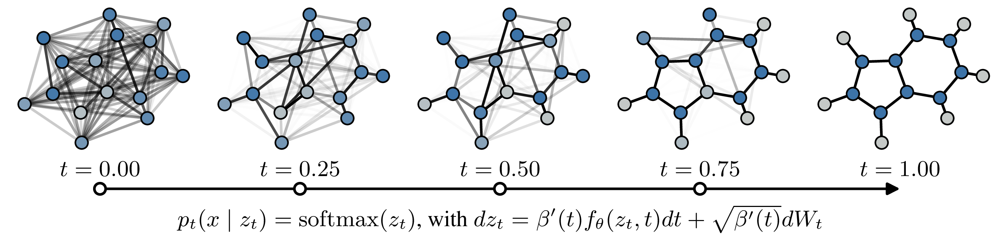

# GraphBSI: Discrete Bayesian Sample Inference for Graph Generation



Reference implementation of
[**Discrete Bayesian Sample Inference for Graph Generation**](https://openreview.net/forum?id=py2NPbAdvH)
(ICLR 2026).

GraphBSI generates graphs by iteratively refining a continuous belief over node and
edge categories via Bayesian Sample Inference, with a noise-controlled SDE sampler.

## Installation

The paper results were computed in two locked environments, and an exact
reproduction uses both. `reproduce_all.sh` creates them if they are missing and
`scripts/reproduce.py` runs every table row with the interpreter of the
environment it was originally evaluated in.

| Environment | Created with | Python / PyTorch | Used for |
|-------------|--------------|------------------|----------|
| `.venv` | [uv](https://docs.astral.sh/uv/): `uv sync --frozen` | 3.12 / 2.7.0+cu126 | Moses, GuacaMol, planar, tree, training |
| `.pixi` | [Pixi](https://pixi.sh): `pixi install --frozen` | 3.13 / 2.8.0+cu128 | SBM |

**`graph-tool` is required for the SBM numbers.** It only exists on conda-forge,
which is why the SBM rows use the Pixi environment. Without it,
`synthetic-graph-benchmarks` silently falls back to a spectral-clustering
approximation of the SBM validity test and reports roughly 18 % V.U. where the
paper reports 61 %. The PyTorch 2.8 build in the Pixi environment no longer
supports Pascal GPUs (GTX 10xx); run the SBM rows on a newer GPU.

## Quick start: reproduce paper metrics from checkpoints

```bash
# One command: creates .venv (uv/pixi) if needed, downloads the checkpoints and
# reproduces every row of Tabs. 1 and 2 into results/metrics.md
bash reproduce_all.sh
```

`reproduce_all.sh` runs unattended and uses every visible GPU (one row per GPU);
override with `--jobs N`. A smoke test that finishes in minutes:

```bash
bash reproduce_all.sh --quick --datasets planar
```

Individual pieces:

```bash
python scripts/download_checkpoints.py           # ~1.3 GB from the Hub
python scripts/download_data.py --dna            # optional, Table 3 assets
python scripts/reproduce.py --tables 1 2 --list  # show the configurations
python scripts/reproduce.py --rows moses:ou_500
python scripts/reproduce.py --all --jobs 4       # incl. Tabs. 3/6 and Fig. 9
python scripts/summarize.py                      # rebuild results/metrics.md
```

Molecular / synthetic-graph datasets are downloaded automatically on first run via
[`molecule-benchmarks`](https://pypi.org/project/molecule-benchmarks/) and
[`synthetic-graph-benchmarks`](https://pypi.org/project/synthetic-graph-benchmarks/).

### What gets reproduced

`results/metrics.md` puts the published numbers next to the reproduced ones and
flags every metric that falls outside tolerance. The committed `results/` folder
is a reproduction of Tabs. 1 and 2 from the released checkpoints: all 72
compared metrics are within tolerance and 61 are identical to the paper at its
printed precision. See [REPRODUCTION.md](REPRODUCTION.md) for how each row
replays its paper run and which rows cannot be replayed exactly.

| Dataset | Paper | Checkpoint | Main metrics |
|---------|-------|------------|--------------|
| Moses | Table 1 | `final_checkpoints/moses/last.ckpt` | Validity, Unique, Novel, Filters, FCD, SNN, Scaf. |
| GuacaMol | Table 1 | `final_checkpoints/guacamol/{last,epoch_59}.ckpt` | Validity, V.U., V.U.N., KL, FCD |
| Planar / SBM / Tree | Table 2 | `final_checkpoints/{planar,sbm,tree}/last.ckpt` | V.U., mean ratio |
| FlyBrain / MEL2 | Table 3 | `final_checkpoints/{flybrain,mel2}/last.ckpt` | FBD |
| QM9 (±H) | Table 6 | `final_checkpoints/qm9[_with_h]/last.ckpt` | Validity, FCD, … |
| Toy sequences | Figure 9 | `final_checkpoints/toy_sequence/alphabet_*.ckpt` | `kl_forward` vs vocab size |

Each table row is one entry in `ROWS` in `scripts/reproduce.py`, holding the
discretization scheme (Euler-Maruyama / Ornstein-Uhlenbeck), the number of
function evaluations and the noise level `γ` that was tuned for it, e.g. Moses
uses `γ = 10/20` at 50 steps and `γ = 100/90` at 500 steps (EM/OU). The published
numbers themselves live in `scripts/paper_values.py`.

GuacaMol training was continued across several runs. The 50-step Euler row of
Tab. 1 was produced with the epoch-59 checkpoint (`guacamol/epoch_59.ckpt`), the
other three GuacaMol rows with the epoch-89 one (`guacamol/last.ckpt`); both are
released and `scripts/reproduce.py` picks the right one per row.

The V.U. column of Tab. 2 is the benchmark's validity-uniqueness accuracy
(`<dataset>_acc`, e.g. `sbm_acc`) over 200 generated graphs scored in 5 batches
of 40, reported as mean ± standard deviation over the batches.

Note that the precision schedule is part of the *checkpoint*: the molecular
models were trained with `belief.scheduler.final_precision=12.0`, planar/SBM with
`20.0` and tree with `25.0`. The experiment configs pin these values; overriding
them silently degrades every metric.

Extra Hydra overrides can be appended, e.g.:

```bash
python scripts/reproduce.py --rows moses:ou_500 \
  --override task.sampler.variable_noise.step_method.noise_scale=100
```

## Training

```bash
python train.py experiment=moses/train
python train.py experiment=guacamol/train
python train.py experiment=planar/train
python train.py experiment=sbm/train
python train.py experiment=tree/train
python train.py experiment=qm9/train
python train.py experiment=flybrain/train
python train.py experiment=mel2/train
python train.py experiment=toy_sequence/train
```

Optional: submit via SLURM using the generic launcher example in
`config/hydra/launcher/slurm.yaml`:

```bash
python train.py -m experiment=moses/train hydra/launcher=slurm
```

## Tests

```bash
uv run pytest   # ~1 min on a GPU; test_molecules downloads QM9 into a temp dir
```

## Checkpoints on Hugging Face

Paper checkpoints live in `peteole/graphbsi-checkpoints`. To (re)upload after
changing local `final_checkpoints/`:

```bash
huggingface-cli login
python scripts/upload_checkpoints.py
```

## Project layout

```
config/                 # Hydra configs (experiments, data, samplers, plots)
project/                # Model, beliefs, samplers, data modules, callbacks
scripts/
  download_checkpoints.py
  upload_checkpoints.py
  download_data.py      # DNA pickles + FBD classifiers
  reproduce.py          # Metric reproduction entrypoint (one job per table row)
  paper_values.py       # Published Tab. 1 / Tab. 2 numbers
  summarize.py          # results/*.json -> results/metrics.md
reproduce_all.sh
final_checkpoints/      # Populated by download_checkpoints.py (gitignored)
train.py
```

## Citation

```bibtex
@inproceedings{petersen2026graphbsi,
  title     = {Discrete Bayesian Sample Inference for Graph Generation},
  author    = {Ole Petersen and Marcel Kollovieh and Marten Lienen and Stephan G{\"u}nnemann},
  booktitle = {International Conference on Learning Representations (ICLR)},
  year      = {2026},
  url       = {https://openreview.net/forum?id=py2NPbAdvH}
}
```

## License

MIT
