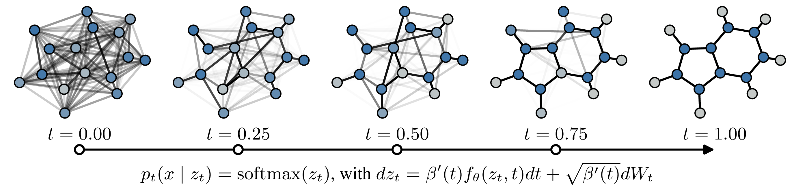

# GraphBSI: Discrete Bayesian Sample Inference for Graph Generation



Reference implementation of
[**Discrete Bayesian Sample Inference for Graph Generation**](https://openreview.net/forum?id=py2NPbAdvH)
(ICLR 2026).

GraphBSI generates graphs by iteratively refining a continuous belief over node and
edge categories via Bayesian Sample Inference, with a noise-controlled SDE sampler.

> **Beyond the paper.** The sampler also carries two optional corrections that
> improve the FCD of every molecular row of Tab. 1 at an unchanged parameter
> count, unchanged checkpoints and an unchanged number of function evaluations.
> They default to off, so the published rows are reproduced by exactly the code
> that produced them. See [research/notes.md](research/notes.md) for the full
> log, including what did not work, and
> [research/results.md](research/results.md) for the measurements.

## Improved sampler

The reconstructor predicts a *posterior mean*: an average over every molecule
consistent with the current noisy belief. That average lies between real
molecules, so repeatedly steering the belief at it biases samples towards
generic, mode-averaged structures — which is what FCD punishes. Two corrections
push the target further along the direction the reconstructor already proposes.
Both reuse quantities that are already computed, so neither costs a function
evaluation:

- **Multistep extrapolation** (`extrapolation`): feed the belief update a
  linear extrapolation through the previous reconstruction,
  `x_n + w · dt · (x_n − x_{n−1}) / dt_prev`, instead of `x_n` itself.
- **Belief guidance** (`guidance`): feed it `x + w · (x − softmax(belief))`,
  which over-relaxes the update direction.

```bash
python train.py experiment=moses/improved      # 50 NFE, FCD 0.66
python train.py experiment=guacamol/improved   # 50 NFE, FCD score 80.9
```

Each config documents the numbers it produces and the budget it is tuned for.
The knobs are plain Hydra overrides, e.g.
`task.sampler.variable_noise.step_method.guidance=0.5`.

Both corrections live in `CorrectedVariableNoiseStep`
(`project/samplers/step_methods/corrected_variable_noise_step.py`), a subclass of
the released `VariableNoiseStep` that is selected by its own sampler group,
`config/task/sampler/corrected_variable_noise_sampler.yaml`. It keeps the option
key `variable_noise`, so existing override paths still apply, and with
`extrapolation=0 guidance=0` it is bit-identical to the released step method.
No existing sampler code, config or metric key changes, so
`scripts/reproduce.py` still replays the paper rows byte for byte.

### New experiments after the paper

The rows below are **not** in the paper and are not a reproduction of it: they
are new experiments, run after it, with the corrected sampler on the released
checkpoints. Each one mirrors the paper row above it — same checkpoint, same
seed, same 25 000 / 15 000 samples, same number of function evaluations, same
parameter count — and differs only in the sampler. The paper's own rows are
reproduced separately and unchanged in [results/metrics.md](results/metrics.md).

They are registered in `scripts/reproduce.py` like any other row and are
excluded from the paper comparison, so the reproduction summary still compares
exactly the 72 published metrics it did before:

```bash
python scripts/reproduce.py --tables new --list   # the six new rows
python scripts/reproduce.py --tables new          # run them
```

Moses, 25 000 samples:

| | FCD ↓ | Scaf ↑ | Nov. | Val. | Uniq. | Filters | SNN |
|---|---|---|---|---|---|---|---|
| paper, Euler 50 | 1.06 | 15.2 | 96.5 | 99.3 | 100.0 | 96.9 | 0.50 |
| **new, Euler 50** | **0.659** | 15.3 | 95.1 | 99.6 | 100.0 | 98.1 | 0.516 |
| paper, OU 50 | 1.19 | 15.1 | 94.6 | 99.7 | 100.0 | 98.2 | 0.52 |
| **new, OU 50** | **0.882** | 14.8 | 94.3 | 99.7 | 100.0 | 98.4 | 0.526 |
| paper, Euler 500 | 0.72 | 14.3 | 92.5 | 99.8 | 100.0 | 99.1 | 0.54 |
| **new, Euler 500** | **0.669** | **16.3** | 94.0 | 99.8 | 100.0 | 98.8 | 0.525 |
| paper, OU 500 | 0.90 | 12.7 | 90.7 | 99.9 | 100.0 | 99.2 | 0.55 |
| **new, OU 500** | **0.804** | 13.8 | 91.8 | 99.9 | 100.0 | 99.2 | 0.543 |

GuacaMol, 15 000 samples:

| | FCD ↑ | KL ↑ | V.U.N. ↑ | V.U. | Val. |
|---|---|---|---|---|---|
| paper, Euler 50 | 65.6 | 90.7 | 97.2 | 97.5 | 97.5 |
| **new, Euler 50** | **69.3** | **91.4** | **97.5** | 97.8 | 97.8 |
| paper, OU 50 | 71.3 | 93.7 | 98.7 | 99.2 | 99.2 |
| **new, OU 50** | **80.9** | 93.7 | 98.7 | 99.2 | 99.3 |

FCD improves on all six rows, by 0.05–0.4 on Moses and 3.7–9.6 points on
GuacaMol. It is the only metric that improves everywhere: novelty loses about a
point at 50 evaluations on Moses, and single columns move the wrong way by less
than their run-to-run spread (Moses OU 50 scaffold similarity, Moses Euler 500
filters). The Moses 50-evaluation row beats the paper's 500-evaluation FCD, and
ten times more sampling compute then buys only 0.01 further FCD, so the model is
close to saturated at 50 evaluations.

These are the numbers in `results/metrics.md`, each from a single run at the
paper row's seed and a sampling batch size of 125. Repeating a row with a
different seed or batch size moves Moses FCD by up to about ±0.04 and scaffold
similarity by ±1.5, so differences of that size between these numbers and the
ones in `research/results.md` (three seeds, batch 256/512) are draw noise, not
a change in the sampler.

Guidance helps only where the time discretisation is coarse: it is worth about
0.1 FCD at 50 evaluations on Moses, and is counterproductive at 500 evaluations
and on GuacaMol, where only the extrapolation term is used. On GuacaMol at 500
evaluations the corrections *hurt* — 4.5 FCD points on the Euler row, 1.3 KL
points on the OU row — so there is deliberately no new 500-evaluation GuacaMol
row; use `experiment=guacamol/reproduce` at that budget.

## Installation

The paper results were computed in two locked environments, and an exact
reproduction uses both. `reproduce_all.sh` creates them if they are missing and
`scripts/reproduce.py` runs every table row with the interpreter of the
environment it was originally evaluated in.

| Environment | Created with | Python / PyTorch | Used for |
|-------------|--------------|------------------|----------|
| `.venv` | [uv](https://docs.astral.sh/uv/): `uv sync --frozen` | 3.12 / 2.7.0+cu126 | Moses, GuacaMol, planar, tree, training |
| `.pixi` | [Pixi](https://pixi.sh): `pixi install --frozen` | 3.13 / 2.8.0+cu128 | SBM |

**`graph-tool` is required for the SBM numbers.** It only exists on conda-forge,
which is why the SBM rows use the Pixi environment. Without it,
`synthetic-graph-benchmarks` silently falls back to a spectral-clustering
approximation of the SBM validity test and reports roughly 18 % V.U. where the
paper reports 61 %. The PyTorch 2.8 build in the Pixi environment no longer
supports Pascal GPUs (GTX 10xx); run the SBM rows on a newer GPU.

## Quick start: reproduce paper metrics from checkpoints

```bash
# One command: creates .venv (uv/pixi) if needed, downloads the checkpoints and
# reproduces every row of Tabs. 1 and 2 into results/metrics.md
bash reproduce_all.sh
```

`reproduce_all.sh` runs unattended and uses every visible GPU (one row per GPU);
override with `--jobs N`. A smoke test that finishes in minutes:

```bash
bash reproduce_all.sh --quick --datasets planar
```

Individual pieces:

```bash
python scripts/download_checkpoints.py           # ~1.3 GB from the Hub
python scripts/download_data.py --dna            # optional, Table 3 assets
python scripts/reproduce.py --tables 1 2 --list  # show the configurations
python scripts/reproduce.py --rows moses:ou_500
python scripts/reproduce.py --all --jobs 4       # incl. Tabs. 3/6 and Fig. 9
python scripts/summarize.py                      # rebuild results/metrics.md
```

Molecular / synthetic-graph datasets are downloaded automatically on first run via
[`molecule-benchmarks`](https://pypi.org/project/molecule-benchmarks/) and
[`synthetic-graph-benchmarks`](https://pypi.org/project/synthetic-graph-benchmarks/).

### What gets reproduced

`results/metrics.md` puts the published numbers next to the reproduced ones and
flags every metric that falls outside tolerance. The committed `results/` folder
is a reproduction of Tabs. 1 and 2 from the released checkpoints: all 72
compared metrics are within tolerance and 61 are identical to the paper at its
printed precision. See [REPRODUCTION.md](REPRODUCTION.md) for how each row
replays its paper run and which rows cannot be replayed exactly.

| Dataset | Paper | Checkpoint | Main metrics |
|---------|-------|------------|--------------|
| Moses | Table 1 | `final_checkpoints/moses/last.ckpt` | Validity, Unique, Novel, Filters, FCD, SNN, Scaf. |
| GuacaMol | Table 1 | `final_checkpoints/guacamol/{last,epoch_59}.ckpt` | Validity, V.U., V.U.N., KL, FCD |
| Planar / SBM / Tree | Table 2 | `final_checkpoints/{planar,sbm,tree}/last.ckpt` | V.U., mean ratio |
| FlyBrain / MEL2 | Table 3 | `final_checkpoints/{flybrain,mel2}/last.ckpt` | FBD |
| QM9 (±H) | Table 6 | `final_checkpoints/qm9[_with_h]/last.ckpt` | Validity, FCD, … |
| Toy sequences | Figure 9 | `final_checkpoints/toy_sequence/alphabet_*.ckpt` | `kl_forward` vs vocab size |

Each table row is one entry in `ROWS` in `scripts/reproduce.py`, holding the
discretization scheme (Euler-Maruyama / Ornstein-Uhlenbeck), the number of
function evaluations and the noise level `γ` that was tuned for it, e.g. Moses
uses `γ = 10/20` at 50 steps and `γ = 100/90` at 500 steps (EM/OU). The published
numbers themselves live in `scripts/paper_values.py`.

GuacaMol training was continued across several runs. The 50-step Euler row of
Tab. 1 was produced with the epoch-59 checkpoint (`guacamol/epoch_59.ckpt`), the
other three GuacaMol rows with the epoch-89 one (`guacamol/last.ckpt`); both are
released and `scripts/reproduce.py` picks the right one per row.

The V.U. column of Tab. 2 is the benchmark's validity-uniqueness accuracy
(`<dataset>_acc`, e.g. `sbm_acc`) over 200 generated graphs scored in 5 batches
of 40, reported as mean ± standard deviation over the batches.

Note that the precision schedule is part of the *checkpoint*: the molecular
models were trained with `belief.scheduler.final_precision=12.0`, planar/SBM with
`20.0` and tree with `25.0`. The experiment configs pin these values; overriding
them silently degrades every metric.

Extra Hydra overrides can be appended, e.g.:

```bash
python scripts/reproduce.py --rows moses:ou_500 \
  --override task.sampler.variable_noise.step_method.noise_scale=100
```

## Training

```bash
python train.py experiment=moses/train
python train.py experiment=guacamol/train
python train.py experiment=planar/train
python train.py experiment=sbm/train
python train.py experiment=tree/train
python train.py experiment=qm9/train
python train.py experiment=flybrain/train
python train.py experiment=mel2/train
python train.py experiment=toy_sequence/train
```

Optional: submit via SLURM using the generic launcher example in
`config/hydra/launcher/slurm.yaml`:

```bash
python train.py -m experiment=moses/train hydra/launcher=slurm
```

## Tests

```bash
uv run pytest   # ~1 min on a GPU; test_molecules downloads QM9 into a temp dir
```

## Checkpoints on Hugging Face

Paper checkpoints live in `peteole/graphbsi-checkpoints`. To (re)upload after
changing local `final_checkpoints/`:

```bash
huggingface-cli login
python scripts/upload_checkpoints.py
```

## Project layout

```
config/                 # Hydra configs (experiments, data, samplers, plots)
project/                # Model, beliefs, samplers, data modules, callbacks
scripts/
  download_checkpoints.py
  upload_checkpoints.py
  download_data.py      # DNA pickles + FBD classifiers
  reproduce.py          # Metric reproduction entrypoint (one job per table row)
  paper_values.py       # Published Tab. 1 / Tab. 2 numbers
  summarize.py          # results/*.json -> results/metrics.md
research/               # Sampler search behind the corrections above
  notes.md              # Full log, including everything that did not work
  results.md            # Every configuration that was measured
  sota_metrics.md       # Best published value of each metric, with sources
  harness.py            # Sample and score a configuration without Hydra/Lightning
  sweep.py              # Drive the harness over a grid of configurations
reproduce_all.sh
final_checkpoints/      # Populated by download_checkpoints.py (gitignored)
train.py
```

## Citation

```bibtex
@inproceedings{petersen2026graphbsi,
  title     = {Discrete Bayesian Sample Inference for Graph Generation},
  author    = {Ole Petersen and Marcel Kollovieh and Marten Lienen and Stephan G{\"u}nnemann},
  booktitle = {International Conference on Learning Representations (ICLR)},
  year      = {2026},
  url       = {https://openreview.net/forum?id=py2NPbAdvH}
}
```

## License

MIT
